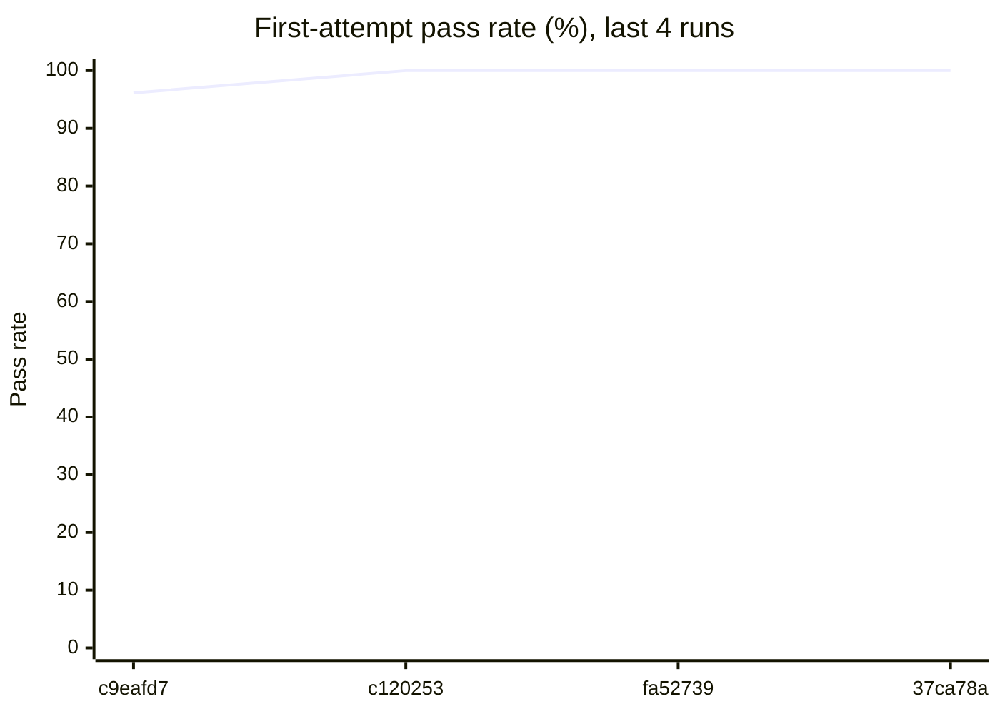
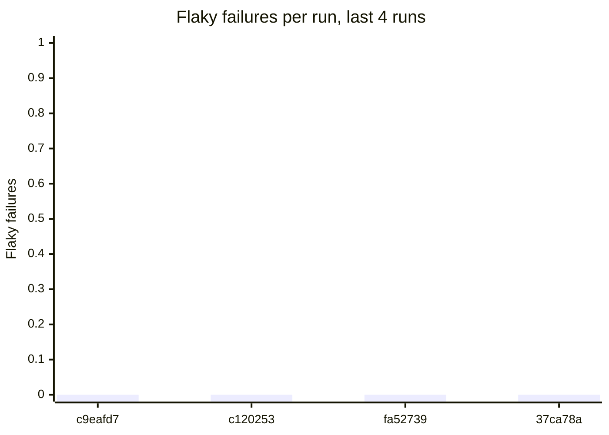
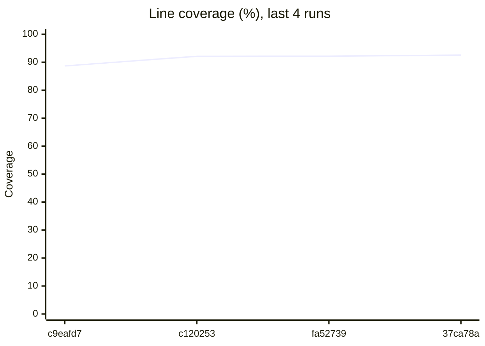

# Flaky test report

**Runs analysed:** 4 (4 on main, 0 from pull requests) · **Tests tracked:** 29 · **Flaky:** 0 (🔴 0 critical, 🟠 0 high, 🟡 0 medium, ⚪ 0 low) · **Consistently failing:** 0

## This run

main · commit `37ca78a` · Fingerprint tests over every file they executed in any run

All 29 tests passed.

## Flaky tests

No flaky tests detected: no test has both passed and failed on the same code.

## Trends

## Coverage

**Total:** 92.54% of 965 statements (+0.41 vs main at `fa52739`) · **This change:** 96.67% of 60 changed statements covered

### Untested lines in this change

| File | Uncovered changed lines |
| --- | --- |
| `flaky_detector/fingerprint.py` | 65, 72 |

### Files no test executes

- `flaky_detector/__main__.py`

### Files below 80% coverage

| File | Coverage | Missing lines |
| --- | --- | --- |
| `flaky_detector/__main__.py` | 0.0% | 1, 3 |

## Graph data

- `runs.csv`: one row per run: pass rate, failures, flaky failures, coverage, diff coverage
- `runs.json`: same as runs.csv, as JSON
- `test_outcomes.csv`: every test attempt in every run (long format, for heatmaps)
- `flaky_tests.json`: flaky and failing tests with stats, onset and per-run timeline
- `coverage_files.csv`: per-file coverage for the latest run with coverage
- `coverage_gaps.json`: files below threshold, never-executed files, uncovered changed lines
