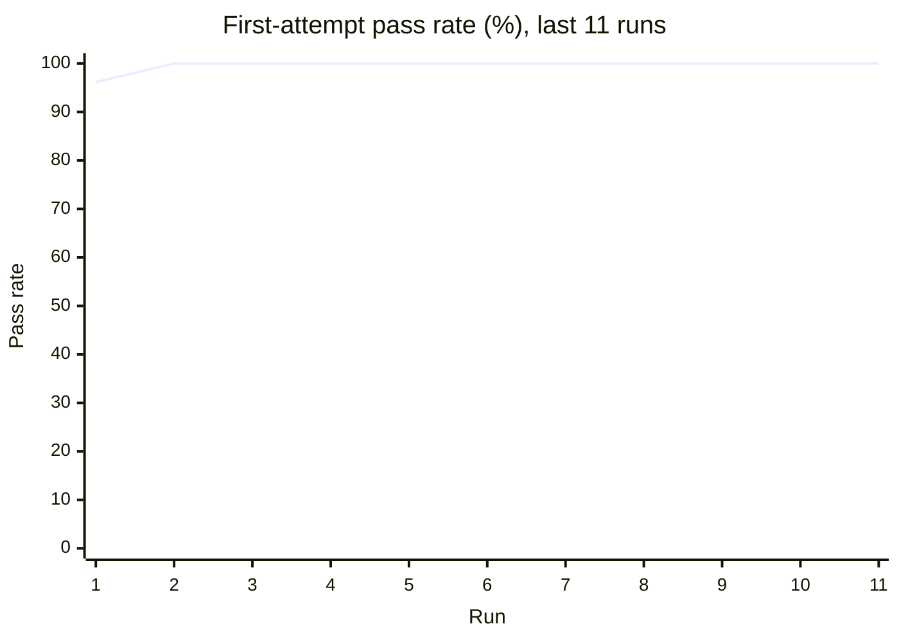
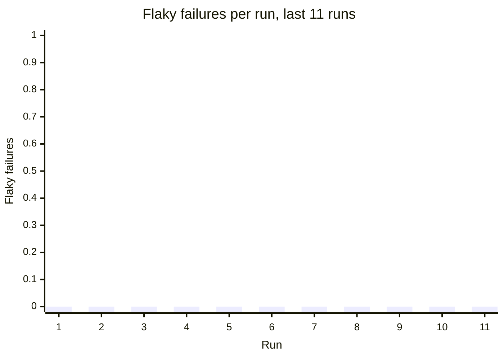
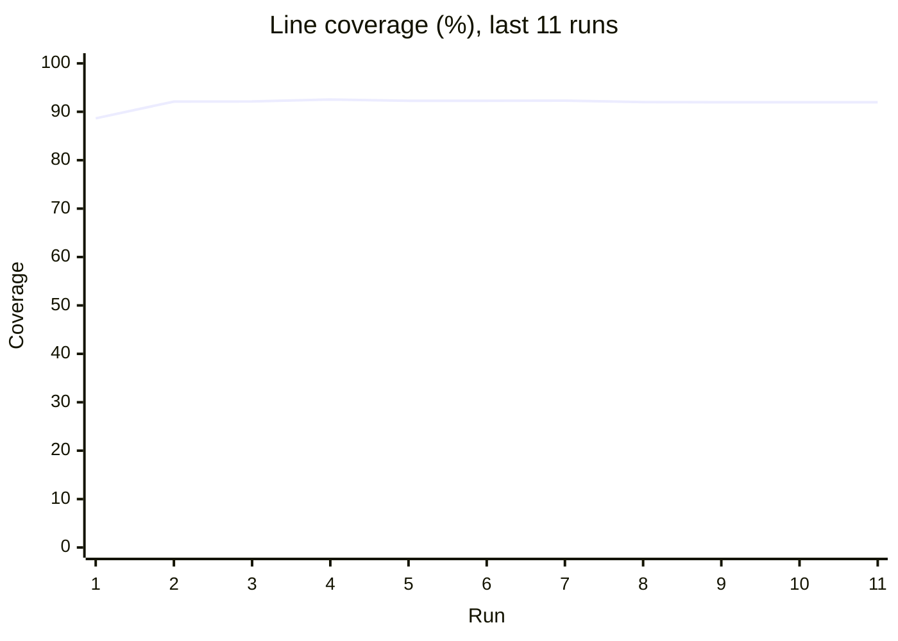

# Flaky test report

**Runs analysed:** 11 (11 on main, 0 from pull requests) · **Tests tracked:** 35 · **Flaky:** 0 (🔴 0 critical, 🟠 0 high, 🟡 0 medium, ⚪ 0 low) · **Consistently failing:** 0 · **Fixed flakes:** 0

## This run

main · commit `8016ecd` · Document versioned pinning and the release process

All 35 tests passed.

## Flaky tests

No flaky tests detected: no test has both passed and failed on the same code.

## Trends

Run key

| Run | Commit | Where | Date |
| --- | --- | --- | --- |
| 1 | `c9eafd7` | main | 2026-10-22 |
| 2 | `c120253` | main | 2026-10-22 |
| 3 | `fa52739` | main | 2026-10-22 |
| 4 | `37ca78a` | main | 2026-10-22 |
| 5 | `fcbe75a` | main | 2026-10-22 |
| 6 | `4c1f6f0` | main | 2026-10-22 |
| 7 | `4d866f2` | main | 2026-10-22 |
| 8 | `d873311` | main | 2026-10-22 |
| 9 | `ec75748` | main | 2026-10-22 |
| 10 | `ec75748` | main (workflow_dispatch) | 2026-10-22 |
| 11 | `8016ecd` | main | 2026-10-22 |

## Coverage

**Total:** 91.96% of 1020 statements (+0.00 vs main at `ec75748`)

### Files no test executes

- `flaky_detector/__main__.py`

### Files below 80% coverage

| File | Coverage | Missing lines |
| --- | --- | --- |
| `flaky_detector/__main__.py` | 0.0% | 1, 3 |
| `flaky_detector/cli.py` | 79.51% | 108-109, 130-131, 134-135, 148, 156-158, 162-163, 165-172, 176, 178-179, 185-186 |

## Graph data

- `runs.csv`: one row per run: pass rate, failures, flaky failures, coverage, diff coverage
- `runs.json`: same as runs.csv, as JSON
- `test_outcomes.csv`: every test attempt in every run (long format, for heatmaps)
- `flaky_tests.json`: flaky and failing tests with stats, onset and per-run timeline
- `coverage_files.csv`: per-file coverage for the latest run with coverage
- `coverage_gaps.json`: files below threshold, never-executed files, uncovered changed lines
